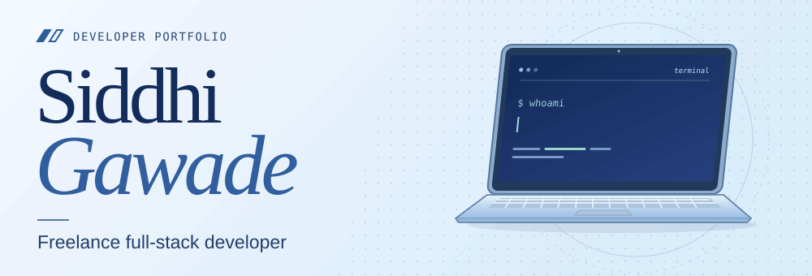

  

  
  
  
  
  

## Hi, I’m Siddhi 👋

I’m a freelance full-stack developer and a Computer Engineering student at Vidyalankar Institute of Technology in Mumbai. I like projects where a small detail changes how someone uses the product. With **Elegance**, that detail was a question I had to answer in code. What changes when someone rents a pair of earrings they could also buy?

I’m also interested in assistive technology and public speaking. I’ve built software that describes a scene aloud, hosted two college podcasts, and led workshops and hackathons with GDG on Campus VIT.

## Featured work

### TTB Experiences · Travel website

**I was the sole developer of TTB Experiences’ customer-facing travel website.** As the Web & Digital Executive Intern, I built the responsive pages and GSAP animations with Astro, TypeScript, JavaScript, and Supabase.

A good place to start is the Japan itinerary. You can follow the trip from Tokyo to Osaka, explore it day by day, and use **Plan a trip** to enquire about a journey of your own.

[Visit TTB Experiences ↗](https://ttbexperiences.com/) · [Explore the Japan itinerary ↗](https://ttbexperiences.com/japan-itinerary.html)

### Elegance · Earring shop and rental platform

I built Elegance so customers could buy earrings outright or rent them with a refundable security deposit. Behind the storefront, I designed the MongoDB models for products, users, and orders, and wrote the REST APIs that manage inventory and purchases.

**Built with** Next.js, Tailwind CSS, Node.js, Express, MongoDB, and Mongoose. [Explore Elegance ↗](https://elegance-mu-amber.vercel.app/)

### More projects

| Project | What I built |
| --- | --- |
| **[LabRooms ↗](https://labrooms.vercel.app/)** | A shared room where people can chat, sketch on one whiteboard, and exchange files. I used WebSockets to keep participants in sync and room codes to control entry. |
| **[Virtual Eye ↗](https://github.com/SiddhiGawade/VirtualEye-Ecosystem)** | An assistive vision system for people with visual impairments. YOLOv8 detects objects, BLIP describes the scene, and text-to-speech reads the description aloud. |
| **[Eventure ↗](https://github.com/SiddhiGawade/Eventure)** | A platform for hosting events and hackathons, a space I also know from organizing them on campus. |

[SaleSmart-AI repository ↗](https://github.com/SiddhiGawade/SaleSmart-AI) · [Browse all repositories ↗](https://github.com/SiddhiGawade?tab=repositories)

## What I work with

| Area | Technologies I’ve used |
| --- | --- |
| Interfaces & motion | React, Next.js, Astro, TypeScript, JavaScript, Tailwind CSS, GSAP |
| APIs & data | Node.js, Express, WebSockets, MongoDB, PostgreSQL, MySQL, Supabase |
| AI & computer vision | Python, PyTorch, OpenCV, YOLOv8, BLIP, TinyML |

At **VJTI Mumbai**, I deployed vision models on an NVIDIA Jetson Nano and worked on real-time voice enhancement for a TinyML hearing aid. At **Digital Techists Consulting**, I built responsive interfaces with React and Tailwind CSS.

## Education & achievements

- **B.Tech in Computer Engineering** · Vidyalankar Institute of Technology, Wadala · **10 CGPA**. I topped my class in Semester 5.
- **Diploma in Computer Engineering** · Bharati Vidyapeeth Institute of Technology, Kharghar · **95.03%**.
- **Hackathons** · National finalist at Quasar (top 60 out of 650+) and 6th place at Synaphack 3.0.
- **Public speaking** · First prize in state-level paper presentation and elocution. I’ve also hosted the Flutter Road Show and Shape The Web.

Away from the keyboard, I’ve captained the girls’ dodgeball team for intra-college tournaments. If you’d like to talk about a freelance build, an accessibility idea, or a hackathon, [say hello on LinkedIn ↗](https://www.linkedin.com/in/siddhi-gawade).
