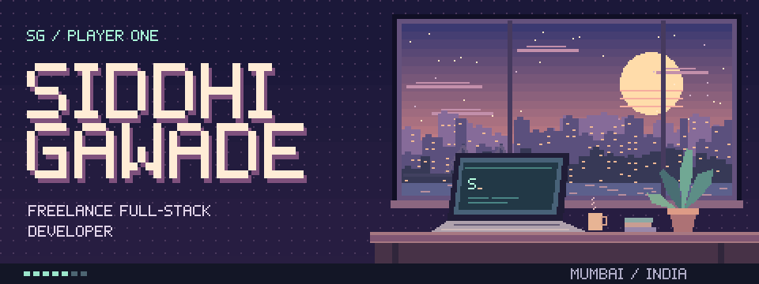
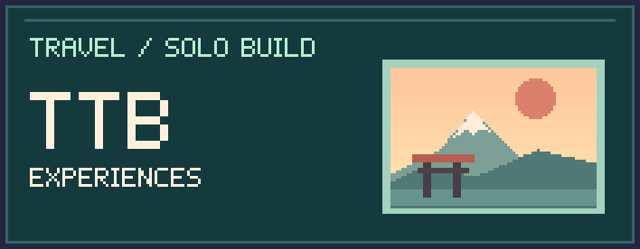
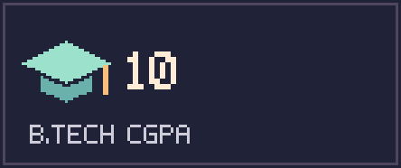
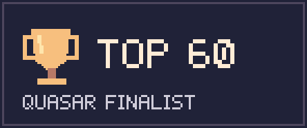
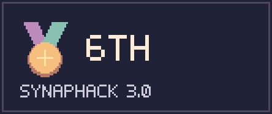

<picture>
  <source media="(prefers-reduced-motion: reduce)" srcset="./assets/title-still.png">
  
</picture>

  <a href="#project-select">▸ Project select</a> &nbsp; · &nbsp;
  <a href="#trophy-room">Trophy room</a> &nbsp; · &nbsp;
  <a href="#bonus-round">Bonus round</a>

# Hi, I’m Siddhi 👋

I’m a **freelance full-stack developer** studying Computer Engineering at Vidyalankar Institute of Technology in Mumbai. I like building the part of an app that makes it useful to someone. Sometimes that’s a rental deposit behind a pair of earrings. Sometimes it’s a voice describing what a camera sees.

Away from my laptop, you might catch me hosting a college podcast, running a GDG workshop, or calling plays on the dodgeball court.

  
  
  
  
  

## Project select

Pick a cartridge to open the live project.

  
  

### TTB Experiences · Solo developer

**I was the sole developer of TTB Experiences’ customer-facing travel website.** As their Web & Digital Executive Intern, I built the responsive itinerary pages and their GSAP animations. Try the Japan itinerary to see how the pages work together. A visitor can go from an overview of the route to a day-by-day plan from Tokyo to Osaka, then enquire about a trip of their own.

`Astro` `TypeScript` `JavaScript` `GSAP` `Supabase`  
[Visit the website ↗](https://ttbexperiences.com/) · [Walk through the Japan itinerary ↗](https://ttbexperiences.com/japan-itinerary.html)

### Elegance · Shop or rent earrings

One pair of earrings, two checkout paths. A customer can purchase it or rent it with a refundable security deposit. I built the storefront, modeled products, users, and orders in MongoDB, and wrote the REST APIs that connect the shop to its inventory.

`Next.js` `Node.js` `Express` `MongoDB` `Mongoose` `Tailwind CSS`  
[Explore Elegance ↗](https://elegance-mu-amber.vercel.app/)

<b>▸ More projects in my collection</b> · LabRooms, Virtual Eye, Eventure &amp; SaleSmart-AI

| Project | What you’ll find |
| --- | --- |
| [LabRooms ↗](https://labrooms.vercel.app/) | A room code brings people into a shared workspace with live chat, a whiteboard, and file sharing. I used WebSockets to keep participants in sync. |
| [Virtual Eye ↗](https://github.com/SiddhiGawade/VirtualEye-Ecosystem) | An assistive vision system that detects nearby objects and narrates a camera scene for someone with a visual impairment. |
| [Eventure ↗](https://github.com/SiddhiGawade/Eventure) | A platform for hosting events and hackathons, something I’ve also done on campus. |
| [SaleSmart-AI ↗](https://github.com/SiddhiGawade/SaleSmart-AI) | Browse the project on GitHub. |

## Trophy room

  
  
  

I topped my class in **Semester 5** at Vidyalankar, after earning **95.03%** in my Computer Engineering diploma at Bharati Vidyapeeth. At Quasar, I reached the **top 60 out of 650+**. I also placed **6th at Synaphack 3.0** and took first prize at a software project competition.

## Developer inventory

| What I’m working on | Tools I reach for |
| --- | --- |
| Interfaces and motion | React, Next.js, Astro, TypeScript, GSAP, Tailwind CSS |
| APIs and real-time systems | Node.js, Express, WebSockets, MongoDB, PostgreSQL, MySQL, Supabase |
| Assistive computing | Python, OpenCV, YOLOv8, BLIP, PyTorch, TinyML |

At **VJTI Mumbai**, I deployed vision models on an NVIDIA Jetson Nano and worked on real-time voice enhancement for a TinyML hearing aid. At **Digital Techists Consulting**, I built responsive interfaces using React and Tailwind CSS.

## Bonus round

**Inside Virtual Eye, which component turns a camera frame into a sentence describing the scene?** Pick an answer to reveal what it does.

▸ YOLOv8

YOLOv8 detects individual objects. It can tell the system that a chair is in the frame. Another component produces the scene description. Try again.

▸ BLIP

**You found it.** BLIP generates a caption from the image. That caption gives the speech component a sentence to read aloud. [Explore Virtual Eye ↗](https://github.com/SiddhiGawade/VirtualEye-Ecosystem)

▸ Text-to-speech

This is the last step. Text-to-speech takes the caption that already exists and reads it aloud. Try the component that works with both images and language.

## Beyond the screen

I’ve hosted **two college podcasts**, led technical events for **GDG on Campus VIT**, and hosted **Flutter Road Show** and **Shape The Web**. Speaking on stage earned me first prize in state-level paper presentation and elocution. On the court, I captained the girls’ dodgeball team for intra-college tournaments.

If you’ve got a freelance project in mind, or you want to talk about accessible interfaces or hackathons, [say hello on LinkedIn ↗](https://www.linkedin.com/in/siddhi-gawade).
